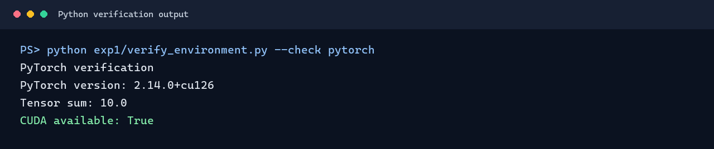
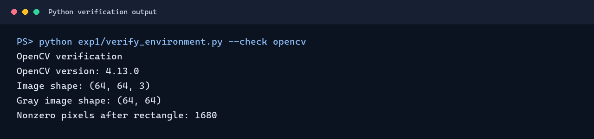
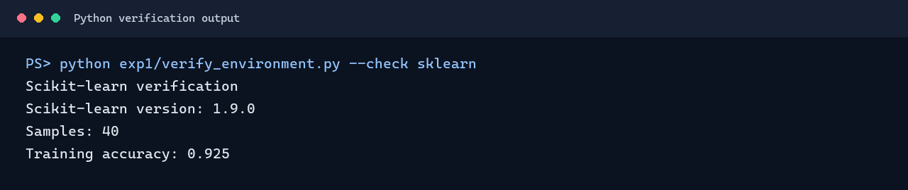
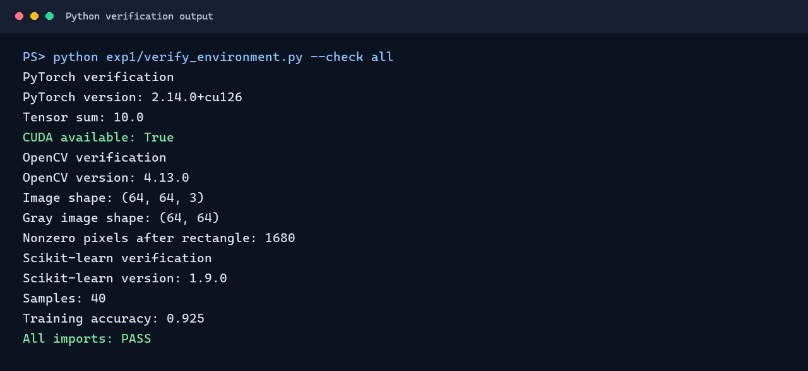

# 计算机视觉实验

本仓库记录计算机视觉实验内容。

## 实验一：开发库环境验证

检查 PyTorch、OpenCV 和 Scikit-learn 的导入及基础功能。以下是实验文档中结果的可视化摘要：









详细实验过程与分析见 [实验一说明](exp1/readme.md)。验证结果以 PNG 图片形式展示。

## 实验二：图像增强

对一张 `1080×1578` 的图片进行颜色转换、加噪和滤波，并用 NumPy 实现彩色中值滤波。


这组实验中，椒盐噪声用中值滤波效果最好，高斯噪声用均值滤波的指标最高。手动中值与 OpenCV 的结果完全一致。

- [实验二报告](exp2/readme.md)
- [实验 Notebook](exp2/code.ipynb)
- [可运行源码](exp2/experiment.py)
- [实验指标](exp2/result/metrics.csv)

在仓库根目录运行（Python 3.12，Windows PowerShell）：

```powershell
python -m venv .venv
.\.venv\Scripts\python.exe -m pip install -r exp2/requirements.txt
.\.venv\Scripts\python.exe exp2/experiment.py
```
