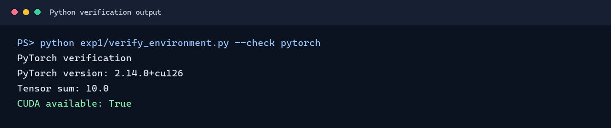
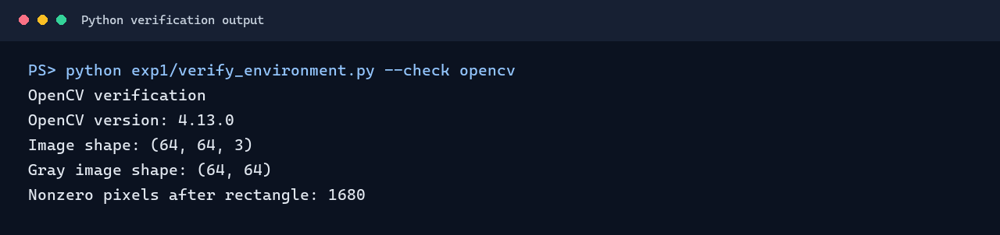
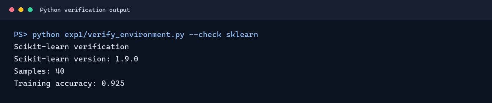
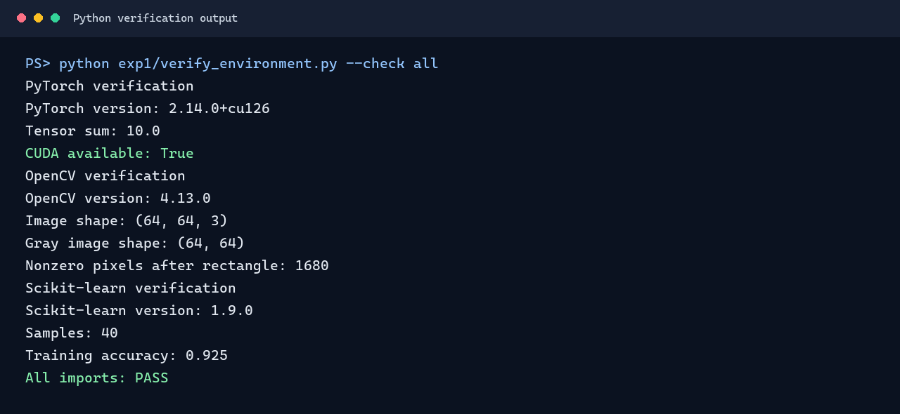
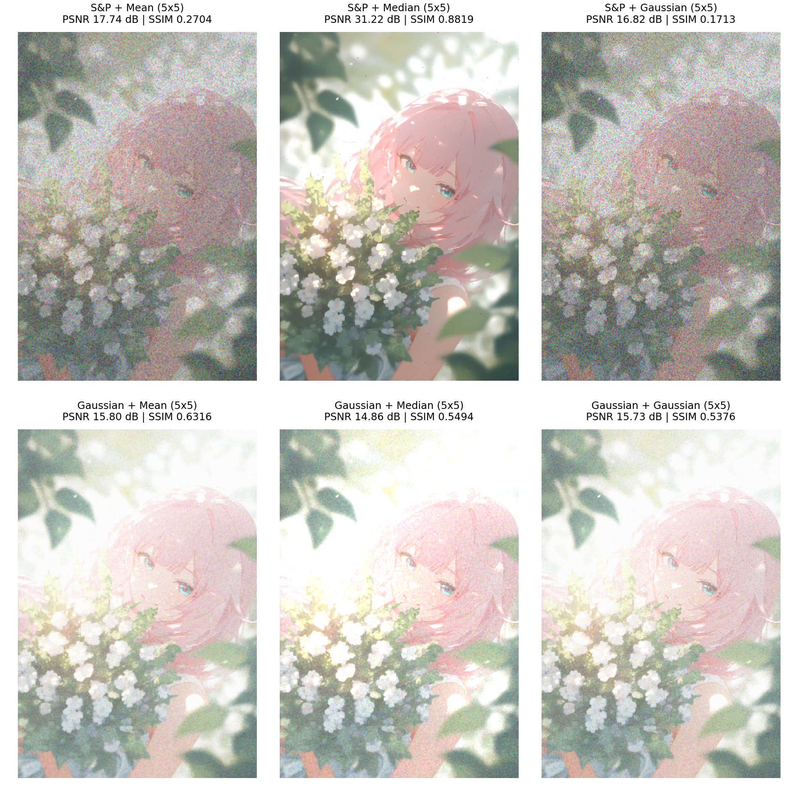
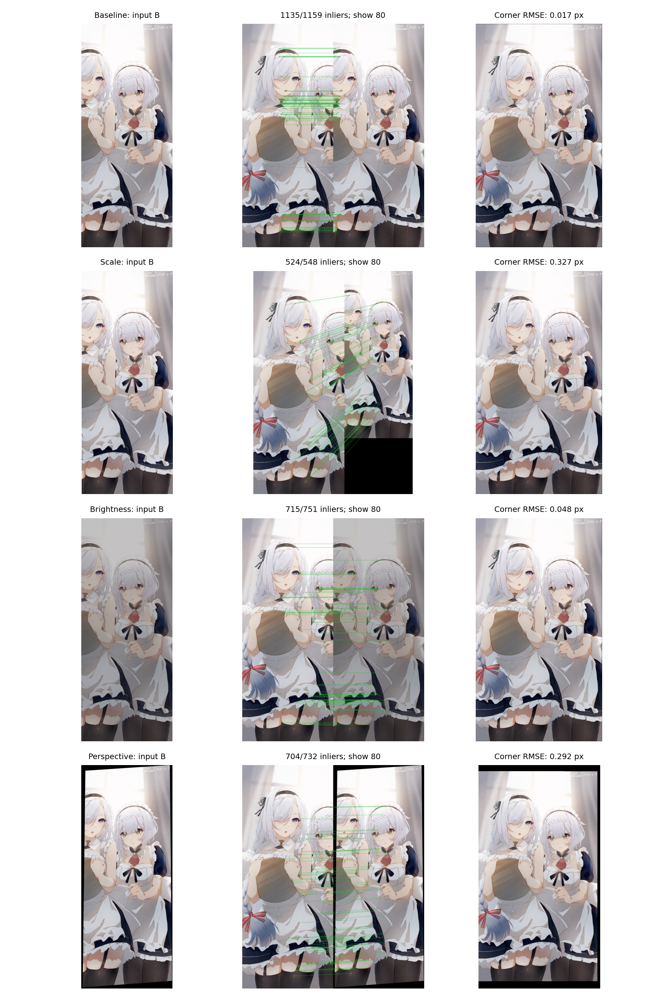
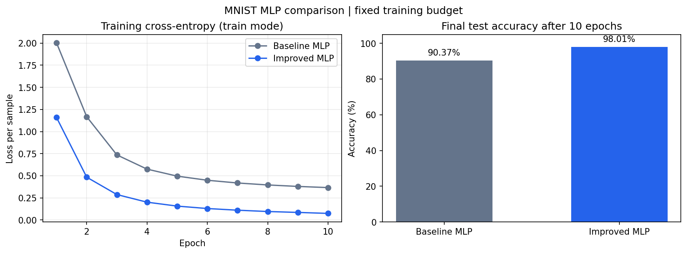

# 计算机视觉实验

本仓库记录计算机视觉实验内容。

## 实验一：开发库环境验证

检查 PyTorch、OpenCV 和 Scikit-learn 的导入及基础功能。以下是实验文档中结果的可视化摘要：









详细实验过程与分析见 [实验一说明](exp1/readme.md)。验证结果以 PNG 图片形式展示。

## 实验二：图像增强

对一张 `1080×1578` 的图片进行颜色转换、加噪和滤波，并用 NumPy 实现彩色中值滤波。



这组实验中，椒盐噪声用中值滤波效果最好，高斯噪声用均值滤波的指标最高。手动中值与 OpenCV 的结果完全一致。

- [实验二报告](exp2/readme.md)
- [实验 Notebook](exp2/code.ipynb)
- [可运行源码](exp2/experiment.py)
- [实验指标](exp2/result/metrics.csv)

在仓库根目录运行（Python 3.12，Windows PowerShell）：

```powershell
python -m venv .venv
.\.venv\Scripts\python.exe -m pip install -r exp2/requirements.txt
.\.venv\Scripts\python.exe exp2/experiment.py
```

## 实验三：图像关键点检测及图像拼接

使用给定的 `3268×5765` 插画裁出重叠视图，分别模拟尺寸、亮度和透视变化。用 SIFT 检测关键点，经 FLANN 匹配和 RANSAC 单应估计后，将图像对齐，再补偿亮度并羽化融合。



四组实验的角点 RMSE 均低于 `0.33 px`。亮度变化组的重叠 MAE 经补偿后从 `38.147` 降至 `0.270`。结果来自同图模拟实验，指标定义与适用范围见报告。

- [实验三报告](exp3/readme.md)
- [实验 Notebook](exp3/code.ipynb)
- [可运行源码](exp3/experiment.py)
- [实验指标](exp3/result/metrics.csv)

在仓库根目录运行（复用前文创建的 `.venv`）：

```powershell
.\.venv\Scripts\python.exe -m pip install -r exp3/requirements.txt
.\.venv\Scripts\python.exe exp3/experiment.py
```

## 实验四：多层感知机

在 MNIST 的 60,000 张训练图像上分别训练基础 MLP 和改进 MLP，各训练 10 轮。基础模型使用 `784 → 128 → 10`、ReLU 和 SGD。改进模型使用 `784 → 256 → 128 → 64 → 10`、BatchNorm、GELU、Dropout 和 Adam。



在 10,000 张测试图像上，基础模型的准确率为 90.37%，改进模型为 98.01%。改进模型高出 7.64 个百分点，少错分 764 张图像。

- [实验四报告](exp4/readme.md)
- [基础模型 Notebook](exp4/code.ipynb)
- [改进模型 Notebook](exp4/code+.ipynb)
- [可运行源码](exp4/experiment.py)
- [实验指标](exp4/result/metrics.csv)

在仓库根目录用 Windows PowerShell 创建 Python 3.12 虚拟环境，再安装依赖并运行实验。

```powershell
python -m venv .venv-exp4
.\.venv-exp4\Scripts\python.exe -m pip install torch==2.14.0 torchvision==0.29.0 --index-url https://download.pytorch.org/whl/cu126
.\.venv-exp4\Scripts\python.exe -m pip install -r exp4/requirements.txt
.\.venv-exp4\Scripts\python.exe exp4/experiment.py
```

上述安装命令适用于支持 CUDA 12.6 的 NVIDIA 环境。CPU 环境可将 PyTorch 安装命令中的索引改为 `https://download.pytorch.org/whl/cpu`，然后运行 `exp4/experiment.py --device cpu`。首次运行下载 MNIST 到 `exp4/.local/data`，之后复用缓存。依赖安装方式见 [PyTorch 官方说明](https://pytorch.org/get-started/locally/)。

使用 `--model baseline` 或 `--model improved` 可单独训练一组。两组的训练轮数、批量大小、随机种子和运行环境等公共配置一致时，脚本会生成对比图。从仓库根目录或 `exp4` 目录运行 Notebook，可加载权重并查看结果。将 `RETRAIN` 设为 `True` 可重新训练。
