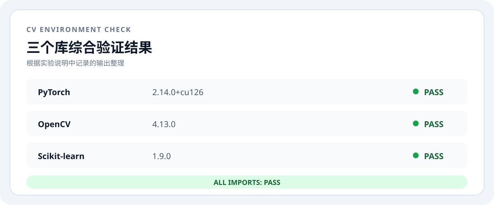

# 实验一：计算机视觉库的安装

## 实验目的：

本实验旨在验证计算机视觉学习所需开发库的安装状态，为后续图像处理、模型训练和机器学习实验准备可用的 Python 环境。本次实验直接使用已经完成配置的环境，不重复执行下载或安装操作，重点检查 PyTorch、OpenCV 和 Scikit-learn 是否能够正常导入，并通过简单功能调用确认库可以正常工作。

## 实验内容：

### 1.验证 PyTorch：

在已配置的 Python 环境中导入 PyTorch，读取版本号，执行张量求和，并检查 CUDA 是否可用。

验证结果显示 PyTorch 版本为 `2.14.0+cu126`，张量计算结果为 `10.0`，CUDA 可用，说明 PyTorch 导入和基本计算均正常。

### 2.验证 OpenCV：

导入 OpenCV 和 NumPy，创建一个三通道图像，绘制矩形并转换为灰度图，以验证 OpenCV 的基本图像处理功能。

验证结果显示 OpenCV 版本为 `4.13.0`，图像尺寸为 `64×64×3`，灰度图尺寸为 `64×64`，矩形处理产生了非零像素，说明 OpenCV 导入、绘图和颜色空间转换均正常。

### 3.验证 Scikit-learn：

导入 Scikit-learn，生成一个小型分类数据集并训练逻辑回归模型，通过训练集准确率确认机器学习模块可以正常调用。

验证结果显示 Scikit-learn 版本为 `1.9.0`，成功生成 `40` 个样本并完成逻辑回归训练，训练集准确率为 `0.925`，说明 Scikit-learn 的数据集、模型训练和评估功能均可用。

## 实验结果与分析：

三个计算机视觉与机器学习库均已完成安装并通过导入验证。综合验证结果如下图所示：

综合输出中 PyTorch、OpenCV 和 Scikit-learn 均成功显示版本号，并返回 `All imports: PASS`。这表明当前 Python 环境可以同时加载三个库，满足后续计算机视觉实验的基础环境要求。

## 实验小结：

本次实验在已有 Python 环境的基础上完成了 PyTorch、OpenCV 和 Scikit-learn 的安装状态验证。验证过程中，PyTorch 完成了张量计算并确认 CUDA 可用；OpenCV 完成了图像创建、绘制和灰度转换；Scikit-learn 完成了分类数据生成、逻辑回归训练和准确率计算。所有导入和功能测试均正常，说明当前环境配置满足后续图像处理、深度学习和传统机器学习实验的使用要求。

