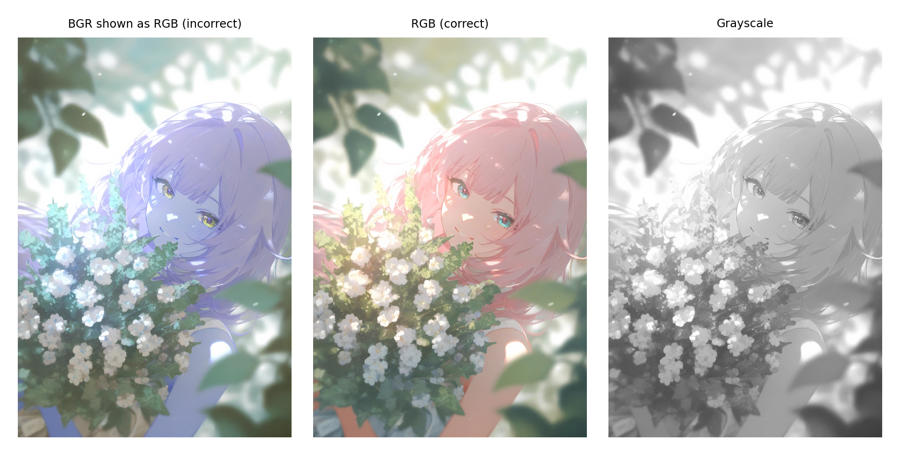
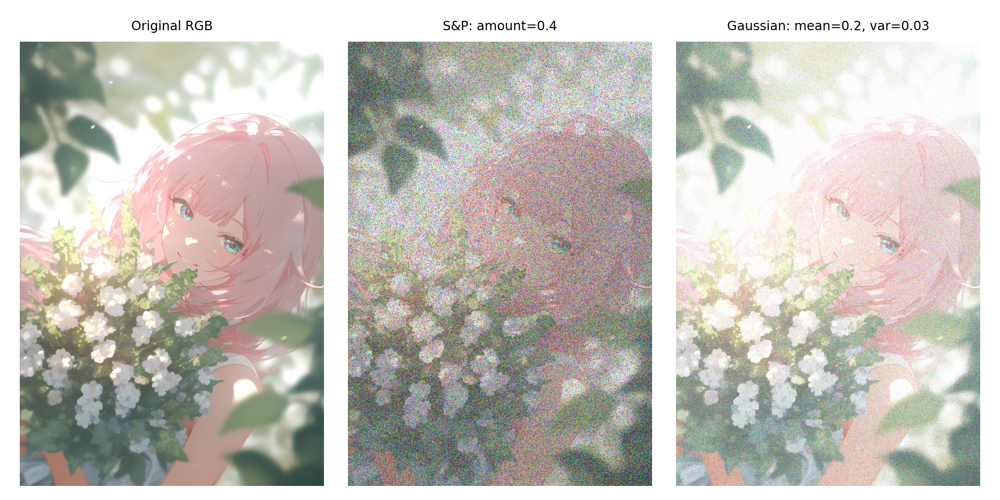
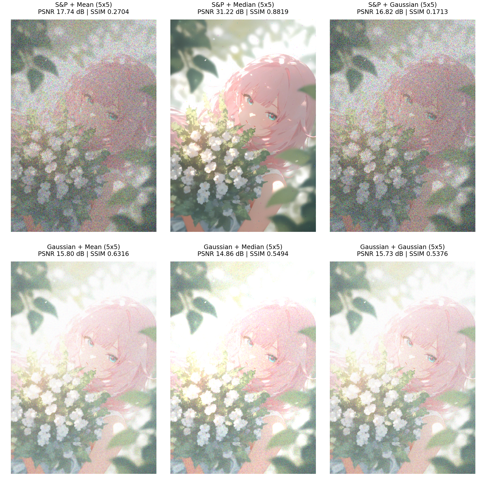
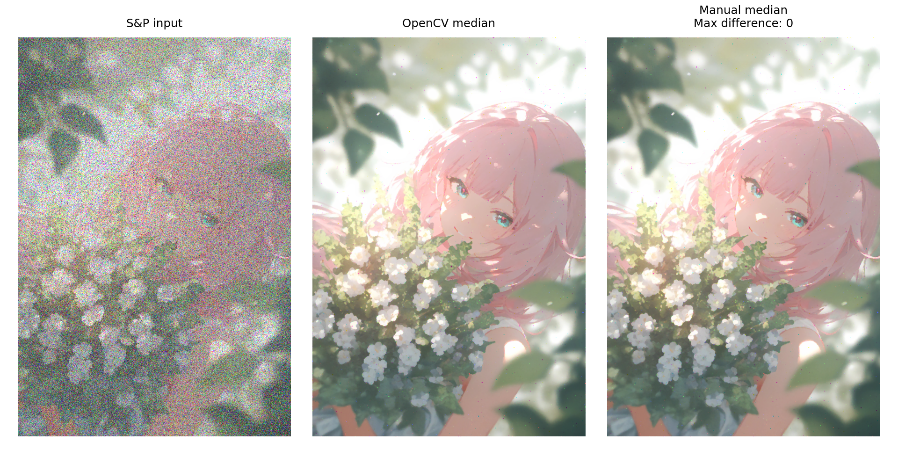

# 实验二：图像增强

实验日期：2026-10-08

按 [参考实验](https://github.com/Guyudong1/CV_exp/tree/main/2nd.exp) 的步骤，对 [input.jpg](assets/input.jpg) 进行颜色转换、加噪和滤波。图片尺寸为 **1080×1578**，处理时保留原始分辨率。完整代码见 [experiment.py](experiment.py) 和 [code.ipynb](code.ipynb)。

## 实验目的

学习 OpenCV 的图像读取和颜色转换方法，比较三种滤波器对不同噪声的处理效果，再用 NumPy 实现彩色中值滤波。

## 实验内容

### 1. 读取图像与颜色转换

图片所在路径含有中文，因此先读取文件字节，再用 `cv2.imdecode` 解码。

```python
bgr = cv2.imdecode(
    np.frombuffer(input_path.read_bytes(), dtype=np.uint8),
    cv2.IMREAD_COLOR,
)
rgb = cv2.cvtColor(bgr, cv2.COLOR_BGR2RGB)

print(bgr.shape)       # (1578, 1080, 3)
print(bgr[100, 100])   # [111 132 123]
print(rgb[100, 100])   # [123 132 111]
```

OpenCV 读取的是 BGR 数组，而 Matplotlib 按 RGB 显示。直接显示 BGR 数组时，图片中的粉色头发会变成偏蓝紫色；转换后才与原图一致。这里改变的是通道顺序。

`[100, 100]` 是从零开始计数的行、列坐标。该像素的 BGR 值为 `[111, 132, 123]`，RGB 值为 `[123, 132, 111]`。

### 2. 灰度转换

```python
gray = cv2.cvtColor(bgr, cv2.COLOR_BGR2GRAY)
write_image(output_dir / "gray_image.png", gray)

plt.imshow(gray, cmap="gray", vmin=0, vmax=255)
plt.axis("off")
```

灰度转换按颜色通道的权重计算亮度。转换后的数组形状为 `(1578, 1080)`，像素 `[100, 100]` 的灰度值为 `127`。下图依次为直接显示 BGR、正确显示 RGB 和灰度图。



[查看完整灰度图](result/gray_image.png)

### 3. 添加噪声

沿用参考实验的参数：椒盐噪声 `amount=0.4`，盐与椒各占一半；高斯噪声均值为 `0.2`、方差为 `0.03`。随机种子分别设为 `2026` 和 `2027`。

```python
sp_float = random_noise(
    rgb, mode="s&p", amount=0.4,
    rng=np.random.default_rng(2026),
)
gaussian_float = random_noise(
    rgb, mode="gaussian", mean=0.2, var=0.03,
    rng=np.random.default_rng(2027),
)

def to_uint8(image):
    return np.rint(np.clip(image, 0.0, 1.0) * 255.0).astype(np.uint8)

sp_noisy = to_uint8(sp_float)
gaussian_noisy = to_uint8(gaussian_float)
```

`random_noise` 返回 `[0, 1]` 范围的浮点数组。乘以 255 并四舍五入后，转成 `uint8` 供后续滤波使用。

椒盐噪声在彩色图上会出现杂色点，因为三个通道分别被随机替换。`amount=0.4` 指通道元素的采样比例；实测 **38.93%** 的通道值、**76.91%** 的像素发生了变化。原有的 0 或 255 被替换为同一数值时，数值不会变化。

高斯噪声图明显偏亮。均值 `0.2` 在裁剪前相当于平均增加 51 个通道灰度级；由于亮部超过上限后被裁剪，实测平均增加 **36.37**，约 **33.24%** 的通道值达到上限。头发高光和白色花朵的细节因此有所损失。



### 4. 均值、中值和高斯滤波

对同一份噪声图像分别使用三种滤波器，窗口均为 `5×5`，边界均复制边缘像素。高斯滤波的 `sigmaX=0`，由 OpenCV 根据窗口大小确定标准差。

```python
kernel_size = 5
mean_image = cv2.blur(
    noisy, (kernel_size, kernel_size),
    borderType=cv2.BORDER_REPLICATE,
)
median_image = cv2.medianBlur(noisy, kernel_size)
gaussian_image = cv2.GaussianBlur(
    noisy, (kernel_size, kernel_size), 0,
    borderType=cv2.BORDER_REPLICATE,
)
```

均值滤波取邻域平均值，中值滤波取中位数，高斯滤波取加权平均值。结果如下：上行为椒盐噪声，下行为高斯噪声；每行依次为均值、中值、高斯滤波。



### 5. 手动中值滤波

每个颜色通道单独处理，取 `5×5` 邻域中 25 个值的中位数。边界用 `mode="edge"` 填充，与 OpenCV 的中值滤波一致。

```python
def manual_median_filter_color(image, kernel_size=5, block_rows=64):
    height = image.shape[0]
    pad = kernel_size // 2
    result = np.empty_like(image)
    for channel_index in range(3):
        channel = np.pad(image[:, :, channel_index], pad, mode="edge")
        for start in range(0, height, block_rows):
            end = min(start + block_rows, height)
            windows = sliding_window_view(
                channel[start:end + 2 * pad, :],
                (kernel_size, kernel_size),
            )
            result[start:end, :, channel_index] = np.median(
                windows, axis=(-2, -1),
            )
    return result

manual = manual_median_filter_color(sp_noisy)
write_image(output_dir / "denoised_sp.png", manual)
```

这里用 NumPy 组织滑动窗口并求中位数，每次处理 64 行，减少中间数组的内存占用。计算过程与逐像素取中值相同，没有调用现成滤波函数。



逐元素比较整幅图像后，两种实现的最大差值为 **0**。[查看完整去噪图](result/denoised_sp.png)

## 实验结果与分析

以原始 RGB 图像为参考计算下表。MSE 越小越好，PSNR 和 SSIM 越大越好；平均误差是输出减原图后，所有通道值的平均差。PSNR 和 SSIM 的数据范围均设为 255。

| 噪声类型 | 处理方法 | MSE | PSNR / dB | SSIM | 平均误差 |
| --- | --- | ---: | ---: | ---: | ---: |
| 椒盐噪声 | 未滤波 | 8404.61 | 8.886 | 0.0185 | −17.913 |
| 椒盐噪声 | 均值滤波 | 1094.99 | 17.737 | 0.2704 | −17.914 |
| 椒盐噪声 | 中值滤波 | **49.09** | **31.221** | **0.8819** | +0.099 |
| 椒盐噪声 | 高斯滤波 | 1351.56 | 16.822 | 0.1713 | −17.916 |
| 高斯噪声 | 未滤波 | 2773.50 | 13.701 | 0.1528 | +36.374 |
| 高斯噪声 | 均值滤波 | **1709.14** | **15.803** | **0.6316** | +36.374 |
| 高斯噪声 | 中值滤波 | 2122.36 | 14.863 | 0.5494 | +41.480 |
| 高斯噪声 | 高斯滤波 | 1738.98 | 15.728 | 0.5376 | +36.378 |

椒盐噪声组中，中值滤波的效果最明显：PSNR 从 `8.886 dB` 提高到 `31.221 dB`，人物轮廓和花束也更接近原图。中值能排除邻域中的极端值；另外两种滤波把噪点参与平均，图上仍留下较多杂色，边缘也更模糊。

高斯噪声组中，均值滤波的三项指标最好，高斯滤波的 PSNR 与它接近。不过，两者处理后的图片仍然偏亮，平均误差都在 `+36.37` 左右。平滑能减弱随机波动，不能去掉噪声中的正均值，也不能找回已经被裁剪的亮部细节。这一排序对应当前图片、噪声参数和 `5×5` 窗口。

原始数值与参数保存在 [metrics.csv](result/metrics.csv) 和 [summary.json](result/summary.json)。

## 实验小结

这张图片的椒盐噪声适合用中值滤波处理，高斯噪声在当前参数下用均值滤波效果更好。手动实现与 OpenCV 的结果完全相同，关键是按通道取邻域中值，并采用相同的边界处理。

## 运行方法

在仓库根目录执行以下命令（Python 3.12，PowerShell）：

```powershell
python -m venv .venv
.\.venv\Scripts\python.exe -m pip install -r exp2/requirements.txt
.\.venv\Scripts\python.exe exp2/experiment.py
```

默认输入为 `exp2/assets/input.jpg`，结果写入 `exp2/result/`。也可以打开 [code.ipynb](code.ipynb)，选择 `.venv` 的 Python 内核并依次运行单元格。两种方式使用同一份算法代码。
