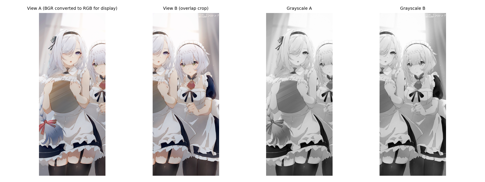
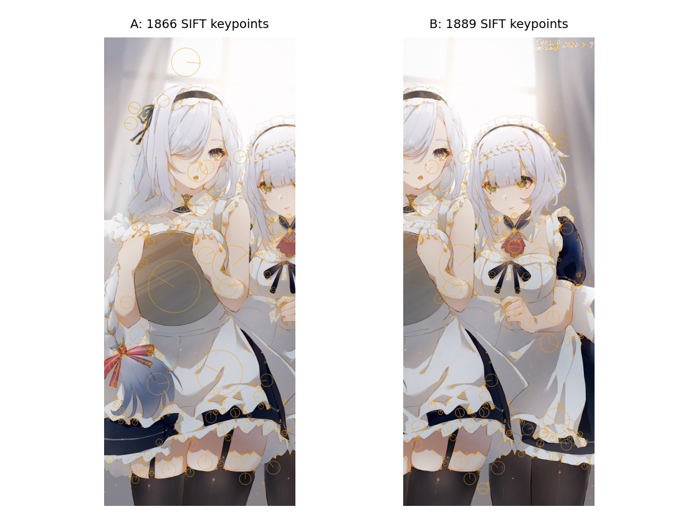
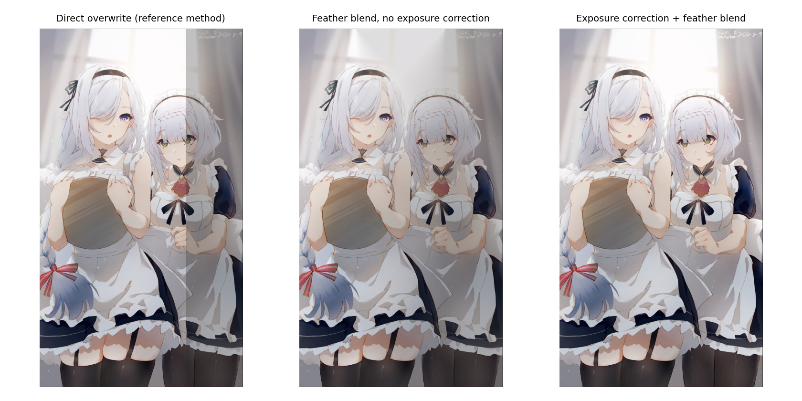
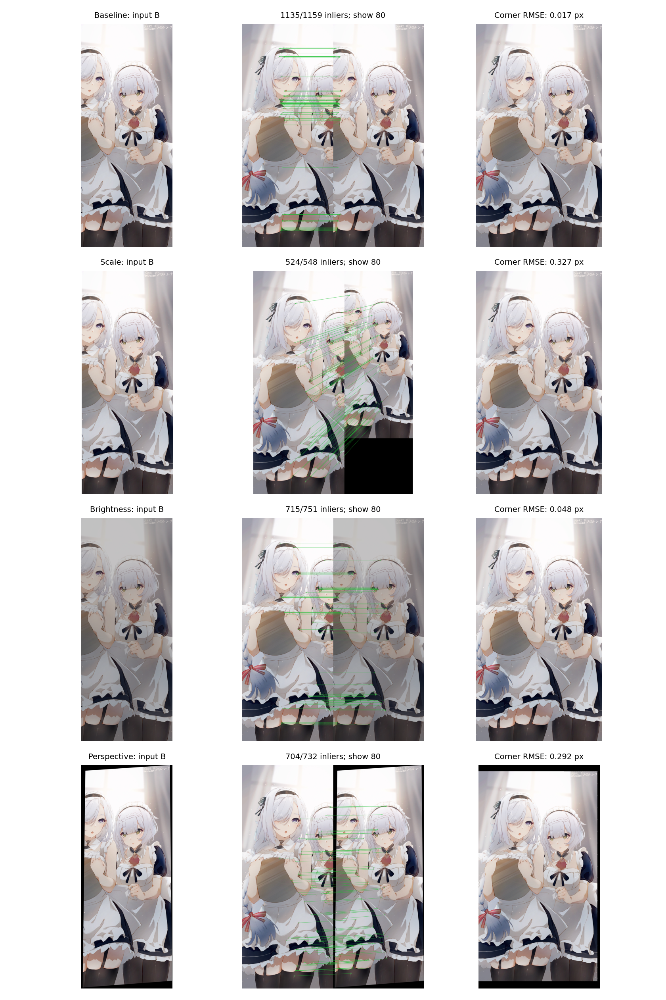

# 实验三：图像关键点检测及图像拼接

实验日期：2026-10-22

本实验以给定插画为素材，按照 [参考实验](https://github.com/Guyudong1/CV_exp/tree/main/3rd.exp) 完成关键点检测、特征匹配与图像拼接。原图见 [input.jpg](assets/input.jpg)，完整代码见 [experiment.py](experiment.py)，分步过程与结果展示见 [code.ipynb](code.ipynb)。

实验先从原图裁出两幅重叠视图，再分别改变其中一幅的尺寸、亮度和透视关系，比较各组的匹配与拼接效果。所有视图均由同一张插画生成，真实拍摄中的视差、运动和遮挡仍需另行验证。

## 实验目的

学习图像局部特征提取、几何配准与融合的基本方法。使用 SIFT（Scale-Invariant Feature Transform，尺度不变特征变换）检测关键点并计算描述符。通过 FLANN（Fast Library for Approximate Nearest Neighbors，近似最近邻检索库）建立候选匹配。再用 RANSAC（Random Sample Consensus，随机采样一致性）估计单应矩阵，完成图像的空间对齐与融合。

## 素材与实验设置

原图尺寸为 `3268×5765`，保留原始文件用于复查。处理时按原宽高比将长边缩至 1800 像素，得到 `1020×1800` 的工作图。后续几何误差均以视图 A 在工作分辨率下的像素为单位。

从工作图左侧裁出视图 A，右侧裁出视图 B，使两幅图像保留共同内容。数组索引从 0 开始，裁剪范围不含右边界。

```python
image_a = working[:, 0:734]
image_b = working[:, 286:1020]
```

A、B 的尺寸均为 `734×1800`。重叠宽度为 `734-286=448` 像素，占单幅视图宽度的 `61.04%`。原图尺寸、裁剪坐标和文件的 SHA-256 摘要见 [summary.json](result/summary.json)。

| 实验组 | A | B | 目的 |
| --- | --- | --- | --- |
| 重叠裁剪 `baseline` | 左侧裁剪视图 | 右侧裁剪视图 | 检查基础匹配和水平配准 |
| 尺寸变化 `scale` | 保持原尺寸 | 宽高缩至 75%，得到 `550×1350` | 检查尺度变化后的匹配 |
| 亮度变化 `brightness` | 保持原亮度 | `round(0.72*B+12)`，裁剪到 `[0,255]` | 比较亮度变化及补偿效果 |
| 透视变化 `perspective` | 保持原视图 | 按已知四角映射生成透视图 | 检查透视单应估计 |

透视组将 B 的四角映射到给定位置，按左上、右上、右下、左下排序。目标坐标依次为 `(0.045w,0.025h)`、`(0.97w,0)`、`(0.995w,0.965h)` 和 `(0.015w,0.995h)`，其中 `w=734`、`h=1800`。输入视图和透视组的有效掩膜保存在 [img](img)。

四组实验使用相同的特征检测、匹配和融合参数，分别考察输入图像变化后的结果。OpenCV 使用单线程，各组随机种子依次为 `2026`、`2027`、`2028` 和 `2029`。

| 步骤 | 参数 |
| --- | --- |
| SIFT | `cv2.SIFT_create()` 默认参数 |
| FLANN | KDTree，`trees=5`、`checks=50`、`k=2` |
| Lowe 比率筛选 | 最近邻距离小于次近邻距离的 `0.7` 倍 |
| RANSAC | 重投影阈值 `5.0` 像素，估计 B→A 的单应矩阵 |
| 亮度补偿 | 在有效重叠区按通道拟合 `A≈gain*B+bias` |
| 图像融合 | 按有效区域边界距离加权羽化 |

## 实验过程

### 1. 读取图像与灰度转换

使用 `cv2.imdecode` 解码文件字节，以支持含中文的路径。OpenCV 读取的彩色图像按 BGR 排列，绘图时转换为 RGB。SIFT 的输入则由彩色图转换为灰度图，彩色数据保留用于后续拼接。

```python
gray_a = cv2.cvtColor(image_a, cv2.COLOR_BGR2GRAY)
gray_b = cv2.cvtColor(image_b, cv2.COLOR_BGR2GRAY)
```

下图依次为彩色 A、彩色 B、灰度 A 和灰度 B。



### 2. SIFT 关键点检测与描述

SIFT 在灰度图中检测关键点，并计算相应的描述符，为后续的局部特征匹配提供依据。基准组中，A 检测到 `1866` 个关键点，B 检测到 `1889` 个关键点。图中的圆圈和方向线分别表示关键点的尺度与主方向。

```python
sift = cv2.SIFT_create()
keypoints_a, descriptors_a = sift.detectAndCompute(gray_a, None)
keypoints_b, descriptors_b = sift.detectAndCompute(gray_b, detection_mask)
```

透视变换会在图像边缘产生填充区域。为避免这些区域参与特征检测，透视图和有效掩膜使用相同的线性插值方式生成，掩膜只保留完全覆盖的像素。检测前再将掩膜内缩，排除填充区域及混合边界产生的特征。



### 3. FLANN 匹配与 Lowe 比率筛选

对 A 中的每个描述符，FLANN 在 B 中检索两个近邻。若两个近邻与查询描述符的距离接近，候选匹配就存在歧义。Lowe 比率筛选保留最近邻距离与次近邻距离之比小于 `0.7` 的匹配。

```python
matcher = cv2.FlannBasedMatcher(
    dict(algorithm=1, trees=5), dict(checks=50)
)
pairs = matcher.knnMatch(descriptors_a, descriptors_b, k=2)
good = [pair[0] for pair in pairs
        if len(pair) == 2 and pair[0].distance < 0.7 * pair[1].distance]
```

基准组共得到 `1866` 组近邻检索结果，筛选后保留 `1159` 对匹配。这些匹配仍可能包含错误对应，需要进一步检验几何关系。

### 4. RANSAC 单应矩阵估计

从筛选后的匹配中提取 B、A 的点坐标，用 RANSAC 估计从 B 到 A 的单应矩阵，并将符合该模型的匹配标为内点。基准组得到 `1135` 对内点，占优质匹配的 `97.93%`，表明筛选后的大部分匹配符合估计的几何关系。

```python
points_b = np.float32([keypoints_b[m.trainIdx].pt for m in good])
points_a = np.float32([keypoints_a[m.queryIdx].pt for m in good])
H, mask = cv2.findHomography(points_b, points_a, cv2.RANSAC, 5.0)
```

基准组估计的单应矩阵如下。横向平移接近已知裁剪偏移 `286` 像素，其余项接近单位矩阵的对应项，与两幅视图仅有水平位移的构造方式一致。

```text
[[ 0.99998983, -0.00001263, 286.00770244],
 [-0.00001465,  1.00000853,  -0.00232062],
 [-0.00000002,  0.00000000,   1.00000000]]
```

匹配图将 RANSAC 内点按描述符距离从小到大排序，最多显示 80 对，避免连线过密。全部匹配数和内点数见下方指标表。


### 5. 画布平移与图像融合

得到单应矩阵后，先将 B 的四角映射到 A 的坐标系，再结合 A 的四角确定完整画布。最小坐标向下取整，最大坐标向上取整，使画布覆盖两幅图像。若变换后出现负坐标，则用平移矩阵 `T` 将其移入画布，B 的最终映射为 `T @ H`。

```python
lower = np.floor(corners.min(axis=0)).astype(int)
upper = np.ceil(corners.max(axis=0)).astype(int)
width, height = (upper - lower + 1).tolist()
T = np.array([[1., 0., -lower[0]],
              [0., 1., -lower[1]],
              [0., 0., 1.]])
warped_b = cv2.warpPerspective(image_b, T @ H, (width, height))
```

图像变换后，用有效掩膜区分图像内容与画布空白，原图中的黑色像素仍作为有效内容保留。将线性插值后完全有效的重叠区向内收缩 2 像素，再用于亮度拟合和误差评价。

融合时先处理两幅图像的亮度差异。在有效重叠区内，按颜色通道拟合 `A≈gain*B+bias`，筛除残差较大的样本后再次拟合，再将补偿关系应用于 B。随后将 A 与补偿后的 B 羽化融合，像素到各自有效区域边界的距离越大，权重越高。

参考实验采用直接覆盖完成拼接，本实验进一步比较羽化与亮度补偿的作用。下图展示亮度组的融合结果，从左到右依次为直接覆盖、仅羽化和亮度补偿后羽化。



## 实验结果与分析

从特征匹配和几何估计两个方面比较四组实验。下表列出关键点数、优质匹配数、RANSAC 内点数和几何误差。内点率为 RANSAC 内点数除以 Lowe 筛选后的优质匹配数。

| 实验组 | A 关键点 | B 关键点 | 优质匹配 | RANSAC 内点 | 内点率 | 内点 RMSE / px | 角点 RMSE / px |
| --- | ---: | ---: | ---: | ---: | ---: | ---: | ---: |
| 重叠裁剪 | 1866 | 1889 | 1159 | 1135 | 97.93% | 0.1151 | 0.0174 |
| 尺寸变化 | 1866 | 1387 | 548 | 524 | 95.62% | 0.5148 | 0.3273 |
| 亮度变化 | 1866 | 1308 | 751 | 715 | 95.21% | 0.1928 | 0.0476 |
| 透视变化 | 1866 | 1928 | 732 | 704 | 96.17% | 0.4948 | 0.2921 |

RMSE（Root Mean Square Error，均方根误差）先计算二维坐标误差的欧氏距离，再求距离的平方均值并开方。内点 RMSE 衡量映射后的内点坐标与 A 中匹配坐标的一致程度。角点 RMSE 则比较 B 的四个矩形角点分别经估计矩阵和已知变换映射后的坐标。两项误差均以 A 在工作分辨率下的像素为单位，分别反映内点拟合情况和角点映射的准确性。

已知裁剪和变换矩阵仅用于计算角点误差。特征匹配、RANSAC 和拼接使用从图像估计的结果。尺寸组的已知变换同时计入实际缩放比例和 OpenCV 缩放的像素中心偏移。

| 实验组 | 补偿前重叠 MAE | 补偿后重叠 MAE | 拼接尺寸（宽×高） |
| --- | ---: | ---: | --- |
| 重叠裁剪 | 0.004 | 0.004 | `1021×1802` |
| 尺寸变化 | 1.437 | 1.437 | `1020×1801` |
| 亮度变化 | 38.147 | 0.270 | `1021×1802` |
| 透视变化 | 1.000 | 1.000 | `1043×1914` |

MAE（Mean Absolute Error，平均绝对误差）用于比较配准后重叠区域的像素差异。计算时，在内缩后的有效重叠区取所有 BGR 通道绝对差的平均值，通道数值范围为 `[0,255]`。结合补偿前后的 MAE，可以观察本次亮度补偿的效果。

基准组的角点误差为 `0.0174 px`，估计变换接近已知水平平移，可作为其余三组的比较基准。尺寸组将 B 缩小后，关键点数从 `1889` 减少至 `1387`，仍得到 `524` 对内点。缩放和再次变换产生的插值误差，使重叠 MAE 高于基准组。

亮度组中，B 的关键点数降至 `1308`，仍得到 `715` 对内点。该组的主要区别体现在融合阶段：配准后直接覆盖会留下可见的明暗接缝，仅羽化会将明暗变化扩散到重叠区。加入亮度补偿后，重叠 MAE 从 `38.147` 降至 `0.270`。这一改善对应本次全局仿射亮度变化。

透视组得到 `704` 对内点，角点误差为 `0.2921 px`。观察拼接图时，还需区分图像内容与画布空白。图中黑边来自透视变换后的画布空白，掩膜将这些区域排除在匹配和重叠指标之外。其他组也可能因估计误差和边界取整而多出少量边缘像素。

下图每行依次为输入 B、内点匹配示意和最终拼接结果。四行依次对应重叠裁剪、尺寸变化、亮度变化和透视变化。



各组完整拼接图：[重叠裁剪](result/panorama_baseline.png)、[尺寸变化](result/panorama_scale.png)、[亮度变化](result/panorama_brightness.png) 和 [透视变化](result/panorama_perspective.png)。完整数据见 [metrics.csv](result/metrics.csv) 和 [summary.json](result/summary.json)。
