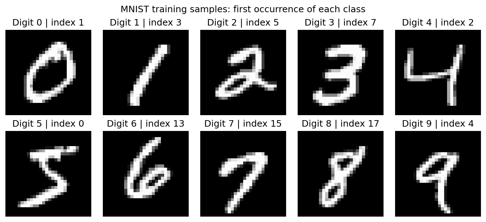
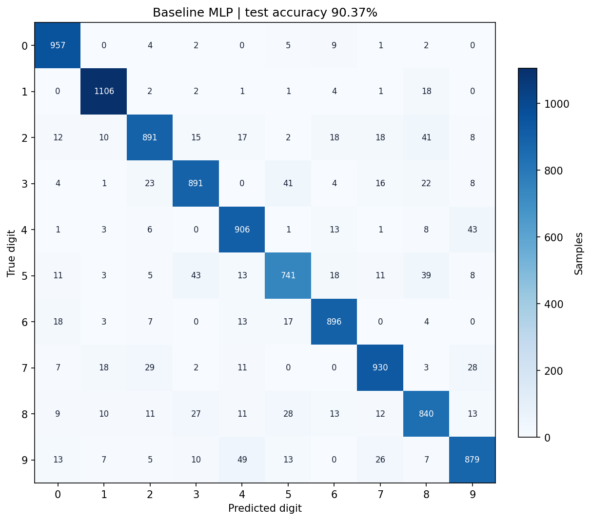
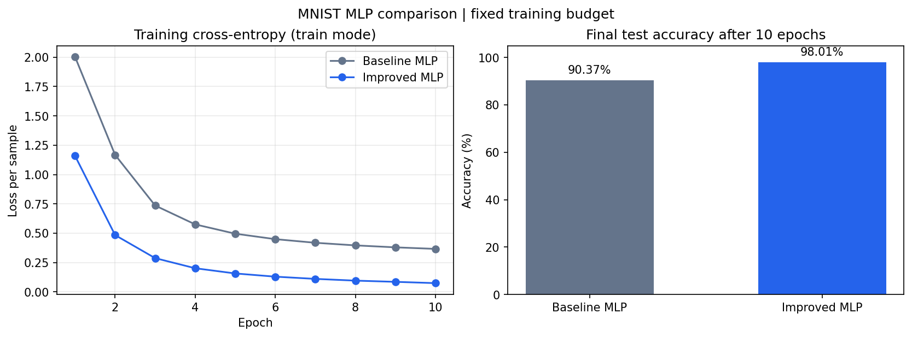
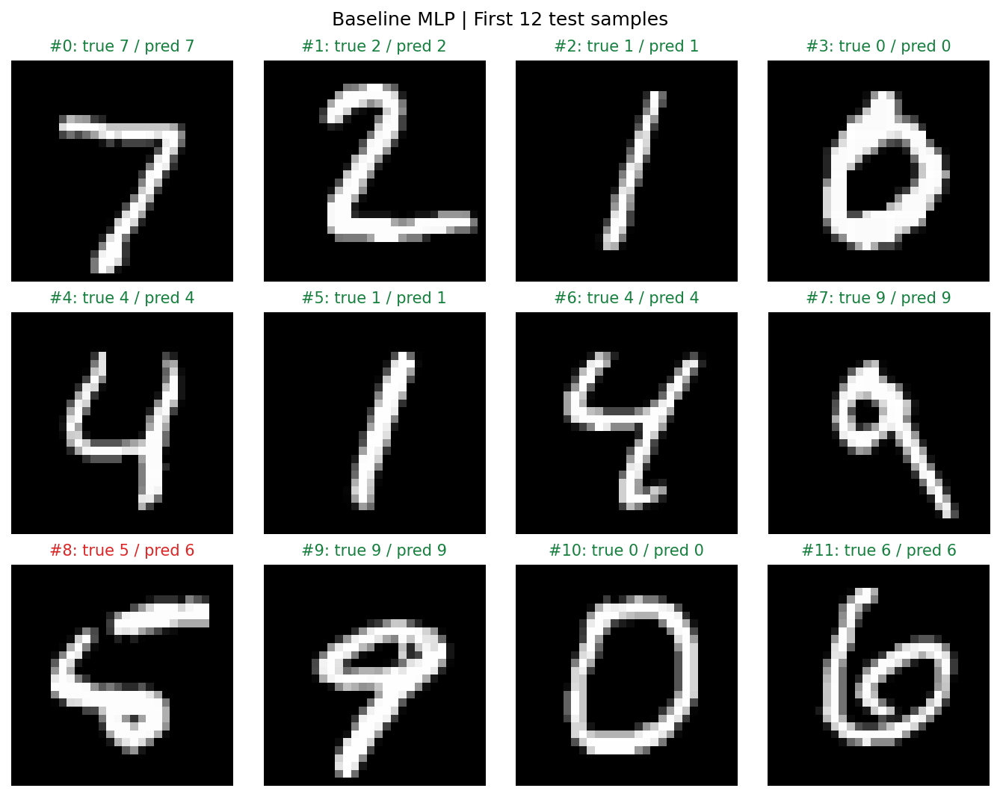

# 实验四：多层感知机

实验日期：2026-11-05

本实验用基础多层感知机（MLP）和改进 MLP 对 MNIST 手写数字进行分类，比较训练损失、测试准确率和分类错误。两组模型沿用参考实验的网络结构和优化器设置。[参考实验](https://github.com/Guyudong1/CV_exp/tree/main/4th.exp)

[实验源码](experiment.py) · [基础模型 Notebook](code.ipynb) · [改进模型 Notebook](code+.ipynb)

## 实验目的

用全连接层和激活函数构建手写数字分类模型。使用交叉熵计算损失，通过反向传播和优化器更新参数，再用混淆矩阵统计各类预测结果。

## 数据与实验设置

MNIST 训练集有 60,000 张图像，测试集有 10,000 张图像。每张图像为 `28×28` 灰度图，对应数字 0 至 9 中的一类。两组模型均使用官方训练集训练，训练结束后在官方测试集上评估。

`torchvision.datasets.MNIST` 将数据下载到 `.local/data`。代码核对压缩文件的 MD5 值，并记录解压文件的 SHA-256 摘要。[实验记录](result/summary.json)

代码将像素从 `uint8` 转为 `float32`，再除以 255，将灰度值缩放到 `[0, 1]`。模型将每张图像展开为 784 维向量。



两组各训练 10 轮。每轮有 30 批，前 29 批各 2048 张，末批 608 张。两组分别以种子 `2026` 初始化模型和训练数据加载器。两组在同一轮使用相同的样本顺序。

| 项目 | 基础模型 | 改进模型 |
| --- | --- | --- |
| 全连接结构 | `784 → 128 → 10` | `784 → 256 → 128 → 64 → 10` |
| 隐藏层数 | 1 | 3 |
| 激活函数 | ReLU | GELU |
| 批归一化 | 无 | 三个隐藏层的线性变换后 |
| 随机失活 | 无 | 前两个隐藏层后，`p=0.3` |
| 优化器 | SGD，学习率 `0.1` | Adam，学习率 `0.001` |
| 可训练参数 | 101,770 | 243,658 |
| 损失函数 | 交叉熵 | 交叉熵 |

实验在 Windows 上运行，使用 NVIDIA GeForce RTX 4090 Laptop GPU 和 CUDA 12.6。软件版本为 Python `3.12.10`、PyTorch `2.14.0+cu126`、torchvision `0.29.0+cu126`、NumPy `2.4.4` 和 Matplotlib `3.10.9`。代码启用确定性算法，关闭 TF32，并将 CPU 线程数设为 4。

## 实验过程

### 1. 构建基础模型

基础模型将 784 维输入映射到 128 维，经 ReLU 激活后输出 10 个类别分数。两个全连接层的权重和偏置共 101,770 个可训练参数。

```python
class BaselineMLP(nn.Module):
    def __init__(self):
        super().__init__()
        self.l1 = nn.Linear(784, 128)
        self.l2 = nn.Linear(128, 10)

    def forward(self, x):
        return self.l2(F.relu(self.l1(x.flatten(1))))
```

交叉熵接收模型输出的原始类别分数（logits）和整数标签。单个样本的损失等于真实类别概率的负对数。

```text
L = -log(exp(z_y) / sum_j exp(z_j))
```

其中 `z_j` 是类别 `j` 的输出分数，`y` 是真实类别。预测标签取 logits 最大值的下标。

### 2. 训练与记录损失

每轮开始调用 `model.train()`。每批先清空梯度，再前向传播、计算交叉熵、反向传播并更新参数。

```python
optimizer.zero_grad(set_to_none=True)
logits = model(x)
loss = F.cross_entropy(logits, y)
loss.backward()
optimizer.step()
```

每轮训练损失等于各批平均损失乘以该批样本数后求和，再除以 60,000。在线训练准确率汇总各批更新参数前的预测，以正确数除以该轮样本总数。


### 3. 构建并训练改进模型

改进模型沿用参考代码的 `784 → 256 → 128 → 64 → 10` 结构，共有四个全连接层。其中前三层是隐藏层，均按“线性变换 → BatchNorm → GELU”处理，前两个隐藏层之后再使用 Dropout。

```python
def forward(self, x):
    x = x.flatten(1)
    x = self.drop(self.act(self.bn1(self.fc1(x))))
    x = self.drop(self.act(self.bn2(self.fc2(x))))
    x = self.act(self.bn3(self.fc3(x)))
    return self.fc4(x)
```

训练时，BatchNorm 使用当前批次的均值和方差，并更新运行统计。Dropout 以 `0.3` 的概率将激活值置零。评估时，BatchNorm 使用已保存的运行统计，Dropout 关闭。


### 4. 测试与混淆矩阵

训练结束后调用 `model.eval()`，在 `torch.inference_mode()` 中按原顺序遍历测试集。测试损失是 10,000 张图像的平均交叉熵。测试准确率是正确预测数除以 10,000。

```python
logits = model(x.to(device))
loss_sum += F.cross_entropy(
    logits, y.to(device), reduction="sum"
).item()
predictions = logits.argmax(1)
```

混淆矩阵的行是真实数字，列是预测数字。每个矩阵的计数之和为 10,000，对角线计数之和为正确预测数。




## 实验结果与分析

### 整体分类效果

| 模型 | 第 10 轮训练损失 | 第 10 轮在线训练准确率 | 测试损失 | 测试准确率 | 正确数 | 错误数 | 宏平均 F1 |
| --- | ---: | ---: | ---: | ---: | ---: | ---: | ---: |
| 基础 MLP | 0.366373 | 89.81% | 0.343137 | 90.37% | 9037 | 963 | 0.9021 |
| 改进 MLP | 0.074482 | 98.07% | 0.067676 | 98.01% | 9801 | 199 | 0.9800 |

每类 F1 是该类精确率和召回率的调和平均。宏平均 F1 是 10 个类别 F1 的算术平均。

改进模型的测试准确率高出 7.64 个百分点，少错分 764 张图像，错误数减少 79.34%。两组训练损失均逐轮下降。第 1 至第 10 轮，基础模型的训练损失从 2.002689 降至 0.366373，改进模型从 1.158893 降至 0.074482。



### 各类别与错误分布

| 数字 | 测试样本数 | 基础正确数 | 基础召回率 | 改进正确数 | 改进召回率 |
| --- | ---: | ---: | ---: | ---: | ---: |
| 0 | 980 | 957 | 97.65% | 967 | 98.67% |
| 1 | 1135 | 1106 | 97.44% | 1125 | 99.12% |
| 2 | 1032 | 891 | 86.34% | 1013 | 98.16% |
| 3 | 1010 | 891 | 88.22% | 993 | 98.32% |
| 4 | 982 | 906 | 92.26% | 955 | 97.25% |
| 5 | 892 | 741 | 83.07% | 878 | 98.43% |
| 6 | 958 | 896 | 93.53% | 940 | 98.12% |
| 7 | 1028 | 930 | 90.47% | 1000 | 97.28% |
| 8 | 974 | 840 | 86.24% | 943 | 96.82% |
| 9 | 1009 | 879 | 87.12% | 987 | 97.82% |

基础模型对数字 5 的召回率最低，为 83.07%。真实数字 5 中有 43 张被判为 3，39 张被判为 8。混淆矩阵中计数最高的非对角线项是 `9 → 4`，共 49 张。

改进模型的 10 类召回率均高于基础模型。混淆矩阵中计数最高的非对角线项是 `4 → 9`，共 17 张，其次是 `7 → 2`，共 13 张。按真实类别统计，数字 8 的误分类最多，共 31 张，召回率为 96.82%。


下图列出两组模型对测试集前 12 张图像的预测。逐样本预测记录在各模型目录的 `test_predictions.csv` 中，索引从 0 开始。




下图按测试集索引列出改进模型前 12 个误分类样本。索引 115 的数字 4 被判为 9，索引 259 的数字 6 被判为 0。


## 实验文件

两组结果目录均包含训练历史、分类指标、逐样本预测、图表和 `model.pth` 权重。[汇总指标](result/metrics.csv) · [基础模型结果](result/baseline) · [改进模型结果](result/improved)

[MNIST 数据接口](https://docs.pytorch.org/vision/stable/generated/torchvision.datasets.MNIST.html) · [交叉熵损失](https://docs.pytorch.org/docs/stable/generated/torch.nn.CrossEntropyLoss.html)
