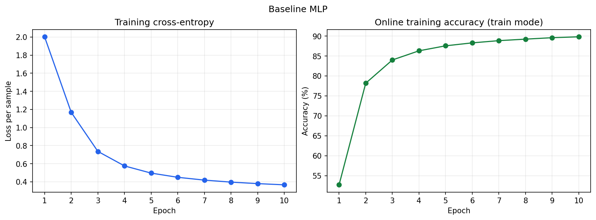
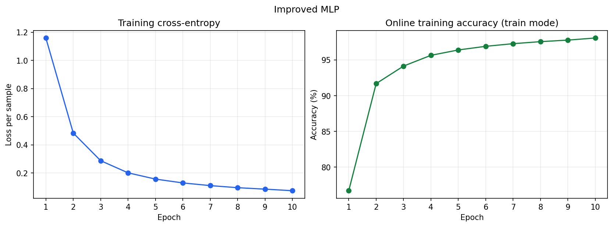
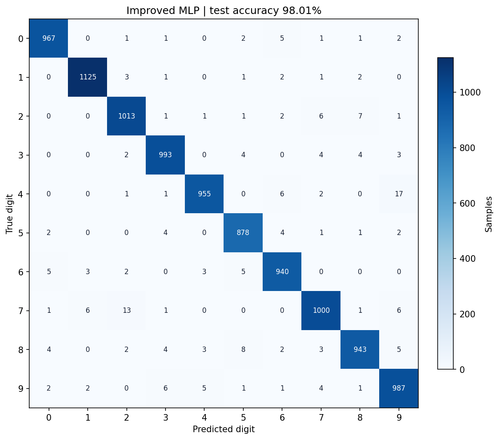
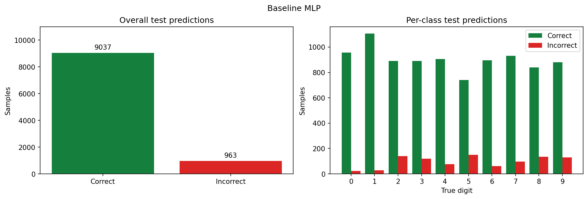
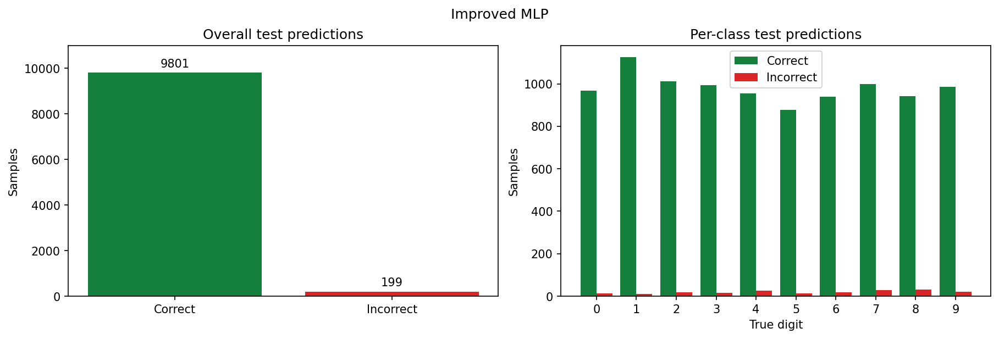
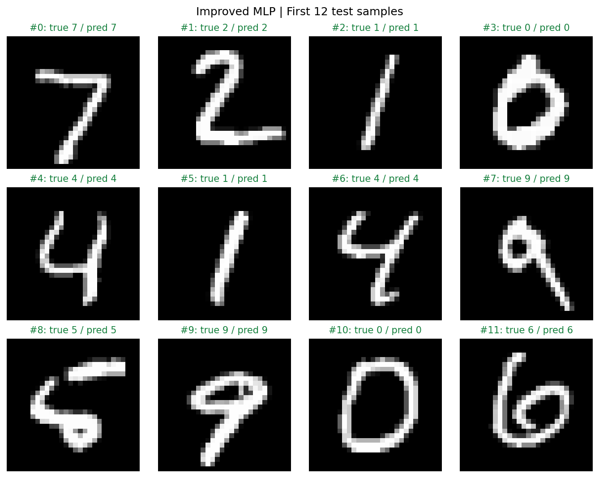
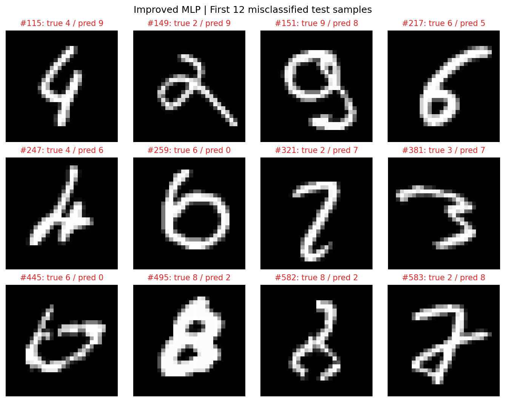

# 实验四：多层感知机

实验日期：2026-11-05

本实验按照 [参考实验](https://github.com/Guyudong1/CV_exp/tree/main/4th.exp) 完成 MNIST 手写数字分类。先训练基础 MLP，再训练加入 BatchNorm、GELU 和 Dropout 的改进模型，比较训练过程和最终测试结果。以下数值与图片均来自本机实际运行。

完整代码见 [experiment.py](experiment.py)。分步说明与已执行输出见 [基础模型 Notebook](code.ipynb) 和 [改进模型 Notebook](code+.ipynb)。

## 实验目的

理解 MLP（Multi-Layer Perceptron，多层感知机）的全连接层、激活函数和前向传播过程。使用交叉熵、反向传播与优化器训练分类模型，掌握训练模式和评估模式的区别，并结合混淆矩阵分析错误。

## 数据与实验设置

MNIST 使用官方划分：训练集 60,000 张，测试集 10,000 张，类别为数字 0 至 9。每张图像为 `28×28` 灰度图。测试集只用于训练结束后的评价，不参与梯度更新，也不用于选择轮数或参数。

数据通过 `torchvision.datasets.MNIST` 下载。压缩文件按 torchvision 提供的 MD5 值检查，解压文件的 SHA-256 摘要记录在 [summary.json](result/summary.json)。缓存位于 `.local/data`，不纳入 Git。

像素先从 `uint8` 转成 `float32`，再除以 255，得到 `[0,1]` 范围。代码一次性转换全部图像，与逐张使用无增强的 `ToTensor()` 等价。输入模型时再展开为 784 维向量。本实验没有使用数据增强或额外标准化。


两组均使用完整训练集、批量大小 `2048` 和 `10` 轮训练。每轮共 30 批，前 29 批各 2048 张，最后一批 608 张。每组训练前重置随机种子 `2026`，数据加载器另设同种子的独立生成器，使两组各轮的样本顺序一致。

| 项目 | 基础模型 | 改进模型 |
| --- | --- | --- |
| 全连接结构 | `784 → 128 → 10` | `784 → 256 → 128 → 64 → 10` |
| 隐藏层数 | 1 | 3 |
| 激活函数 | ReLU | GELU |
| 批归一化 | 无 | 三个隐藏层的线性变换后 |
| 随机失活 | 无 | 前两个隐藏层后，`p=0.3` |
| 优化器 | SGD，学习率 `0.1` | Adam，学习率 `0.001` |
| 可训练参数 | 101,770 | 243,658 |
| 损失函数 | 交叉熵 | 交叉熵 |

运行环境为 Windows、Python `3.12.10`、PyTorch `2.14.0+cu126`、torchvision `0.29.0+cu126`、NumPy `2.4.4` 和 Matplotlib `3.10.9`。计算设备为 NVIDIA GeForce RTX 4090 Laptop GPU，PyTorch CUDA 运行时为 `12.6`。代码启用确定性算法，关闭 TF32，并固定 CPU 线程数为 4。不同设备或库版本仍可能产生数值差异。

## 实验过程

### 1. 构建基础模型

基础模型先将 784 维输入映射到 128 维，再用 ReLU 提供非线性，最后输出 10 个类别分数。两个全连接层包含权重和偏置，可训练参数共 `784×128+128+128×10+10=101770` 个。

```python
class BaselineMLP(nn.Module):
    def __init__(self):
        super().__init__()
        self.l1 = nn.Linear(784, 128)
        self.l2 = nn.Linear(128, 10)

    def forward(self, x):
        return self.l2(F.relu(self.l1(x.flatten(1))))
```

输出为 logits。交叉熵直接接收这些分数和整数类别标签，因此输出层不另加 Softmax。对单个样本，损失为正确类别对应的负对数概率：

```text
L = -log(exp(z_y) / sum_j exp(z_j))
```

其中 `z_j` 是类别 `j` 的输出分数，`y` 是真实类别。预测标签取 logits 最大值的下标。

### 2. 训练与记录损失

每轮开始调用 `model.train()`。每批先清空梯度，再前向传播、计算交叉熵、反向传播并更新参数。

```python
optimizer.zero_grad(set_to_none=True)
logits = model(x)
loss = F.cross_entropy(logits, y)
loss.backward()
optimizer.step()
```

损失按样本数加权，即 `sum(batch_loss×batch_count)/60000`。这使末批的 608 张图像获得正确权重。参考代码直接平均各批损失，末批会与完整批次获得相同权重；本实验使用逐样本平均值。

在线训练准确率汇总每批参数更新前的预测。各批使用的参数不同，因此这项指标描述本轮训练过程。它与最终模型在评估模式下的测试准确率含义不同。



### 3. 构建并训练改进模型

改进模型沿用参考代码的 `784 → 256 → 128 → 64 → 10` 结构，共有四个全连接层。其中前三层是隐藏层，均按“线性变换 → BatchNorm → GELU”处理，前两个隐藏层之后再使用 Dropout。

```python
def forward(self, x):
    x = x.flatten(1)
    x = self.drop(self.act(self.bn1(self.fc1(x))))
    x = self.drop(self.act(self.bn2(self.fc2(x))))
    x = self.act(self.bn3(self.fc3(x)))
    return self.fc4(x)
```

BatchNorm 对隐藏特征做批归一化，并维护推理时使用的运行统计。Dropout 在训练时随机将部分激活置零，以减少神经元之间的共同依赖。评估时，Dropout 关闭，BatchNorm 使用已保存的运行统计。GELU 替换 ReLU，优化器改为 Adam，其余公共训练设置保持一致。



### 4. 测试与混淆矩阵

训练结束后调用 `model.eval()`，并在 `torch.inference_mode()` 中遍历测试集。测试集不打乱顺序。测试损失先累加每张图像的交叉熵，再除以 10,000；准确率为正确数除以 10,000。

```python
logits = model(x.to(device))
loss_sum += F.cross_entropy(
    logits, y.to(device), reduction="sum"
).item()
predictions = logits.argmax(1)
```

混淆矩阵的行是真实数字，列是预测数字。矩阵全部元素之和为 10,000，对角线之和为正确预测数。基础模型对角线总计 9037，改进模型为 9801。




## 实验结果与分析

### 整体分类效果

| 模型 | 第 10 轮训练损失 | 第 10 轮在线训练准确率 | 测试损失 | 测试准确率 | 正确数 | 错误数 | 宏平均 F1 |
| --- | ---: | ---: | ---: | ---: | ---: | ---: | ---: |
| 基础 MLP | 0.366373 | 89.81% | 0.343137 | 90.37% | 9037 | 963 | 0.9021 |
| 改进 MLP | 0.074482 | 98.07% | 0.067676 | 98.01% | 9801 | 199 | 0.9800 |

宏平均 F1 为 10 个类别 F1 的算术平均。每类 F1 综合该类精确率与召回率；精确率按预测为该类的样本计算，召回率按真实属于该类的样本计算。

改进模型的测试准确率提高 `7.64` 个百分点，错误数减少 `764` 张，相对减少约 `79.34%`。两组训练损失均随轮数下降；本次改进配置在相同轮数内达到更低的训练损失和测试损失。


基础模型第 10 轮的训练损失仍在下降。因此，仅凭本次结果不能认定它已达到性能上限，也不能把差距全部归因于隐藏层数量。两组同时改变了结构、激活函数、归一化、随机失活和优化器，区分各因素作用需要单因素消融实验。

改进模型的测试损失略低于在线训练损失。这两项损失来自不同数据和不同模式，训练时 Dropout 启用、BatchNorm 使用当前批次统计。该现象本身不能证明模型没有过拟合。

### 各类别与错误分布

| 数字 | 测试样本数 | 基础正确数 | 基础召回率 | 改进正确数 | 改进召回率 |
| --- | ---: | ---: | ---: | ---: | ---: |
| 0 | 980 | 957 | 97.65% | 967 | 98.67% |
| 1 | 1135 | 1106 | 97.44% | 1125 | 99.12% |
| 2 | 1032 | 891 | 86.34% | 1013 | 98.16% |
| 3 | 1010 | 891 | 88.22% | 993 | 98.32% |
| 4 | 982 | 906 | 92.26% | 955 | 97.25% |
| 5 | 892 | 741 | 83.07% | 878 | 98.43% |
| 6 | 958 | 896 | 93.53% | 940 | 98.12% |
| 7 | 1028 | 930 | 90.47% | 1000 | 97.28% |
| 8 | 974 | 840 | 86.24% | 943 | 96.82% |
| 9 | 1009 | 879 | 87.12% | 987 | 97.82% |

基础模型对数字 5 的召回率最低，为 `83.07%`。其中 43 张被判为 3，39 张被判为 8。基础模型最多的一类定向混淆为 `9 → 4`，共 49 张。

改进模型的 10 类召回率均提高，但仍有相近字形的混淆。其最多的定向混淆为 `4 → 9`，共 17 张；其次为 `7 → 2`，共 13 张。按类别统计，数字 8 的错误最多，为 31 张，召回率为 `96.82%`。





下图固定展示测试集前 12 张图像，便于逐项比较预测。完整测试预测保存在各模型目录的 `test_predictions.csv`，索引从 0 开始。




为观察残余错误，下图按原索引取改进模型前 12 个误分类样本。其中索引 115 的数字 4 被判为 9，索引 259 的数字 6 被判为 0。部分样本的闭合环、弯曲笔画或倾斜形态与其他类别接近，可能增加识别难度。这是对样例的观察，不能替代对全部错误的统计。



### 结果范围

本次基础模型准确率为 `90.37%`，改进模型为 `98.01%`；参考报告给出的对应结果为 `90.52%` 和 `97.95%`。随机初始化、样本顺序和运行环境会影响数值，本实验记录自己的实际结果。

本次只运行一个固定种子，没有独立验证集、重复种子实验或消融实验。结果支持“参考改进配置在本次 MNIST 测试上优于基础配置”，不支持单独判定某个组件的贡献或跨运行稳定性。测试也未覆盖真实拍摄、复杂背景和分布变化下的手写数字。

## 实验小结

本实验完成了数据读取、MLP 构建、10 轮训练、完整测试集推理和错误分析。训练前切换到 `train()`，测试前切换到 `eval()`，使 Dropout 和 BatchNorm 按预期工作。按样本加权记录损失，并用混淆矩阵对角线复核正确数，使图表、指标与逐样本预测对应。

本次改进模型在相同轮数下将测试错误从 963 张降至 199 张。剩余错误仍包含相近字形，后续若比较模型能力，需要保持数据划分一致，并逐项调整结构或训练策略。

完整结果见 [汇总指标](result/metrics.csv)、[基础模型数据](result/baseline) 和 [改进模型数据](result/improved)。两组目录均保留训练历史、分类指标、逐样本预测、图表和可重新加载的 `model.pth` 权重。

原理与接口参考：[MNIST 数据接口](https://docs.pytorch.org/vision/stable/generated/torchvision.datasets.MNIST.html)、[交叉熵损失](https://docs.pytorch.org/docs/stable/generated/torch.nn.CrossEntropyLoss.html) 和 [参考实验源码](https://github.com/Guyudong1/CV_exp/tree/main/4th.exp)。
